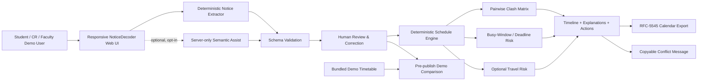
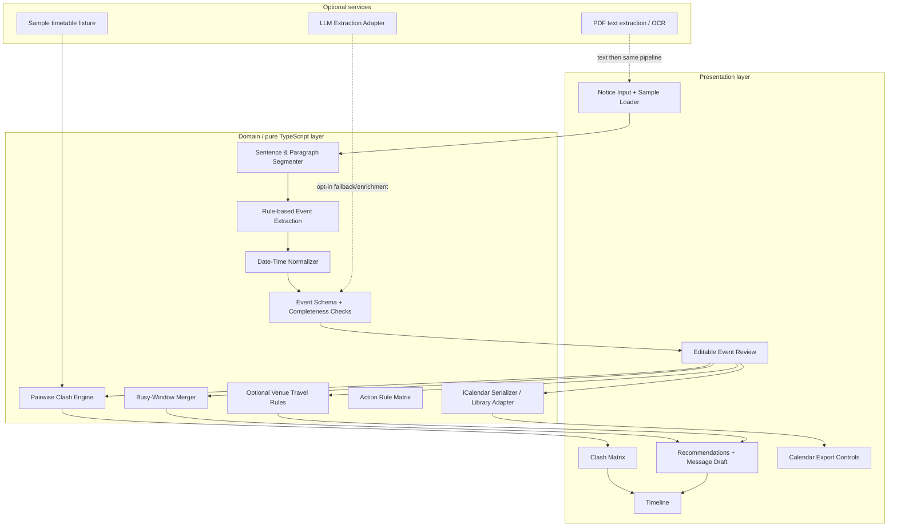
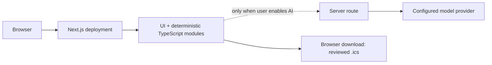

# NoticeDecoder Architecture

## 1. System context



## 2. Layer architecture



## 3. Trust boundaries

- Input notice text is untrusted content.
- Optional AI is an external, fallible dependency and must not bypass validation.
- The core conflict engine receives only normalized, schema-validated, user-reviewed events.
- Browser state should remain ephemeral by default. Add a backend/database only when accounts, shared timetables, or calendar subscriptions are built.
- Faculty demo mode must explicitly identify bundled data as simulated; do not suggest that it checked a real college schedule.

## 4. Main data flow

1. Input is stored in transient UI state.
2. Extractor returns draft events plus source evidence and per-field status.
3. Schema validator catches bad dates, invalid times, missing fields, and impossible ranges.
4. Review UI lets the user fix all fields and mark them confirmed.
5. Derived functions calculate `clashResults`, `mergedBusyWindows`, `travelWarnings`, and `recommendations`. They should be pure functions so unit tests can cover them without rendering React.
6. Timeline, matrix, and action panel render from these derived results.
7. Export serializes the final reviewed event list, not raw extraction output.

## 5. Core module contracts

```ts
extractDraftEvents(text: string, context: ParseContext): DraftEvent[]
validateEvent(event: DraftEvent, context: ValidationContext): ValidationIssue[]
analyzePairwiseClashes(events: ReviewedEvent[]): ClashResult[]
mergeBusyWindows(events: ReviewedEvent[]): BusyWindow[]
recommendActions(events: ReviewedEvent[], results: ClashResult[], windows: BusyWindow[]): Recommendation[]
generateIcs(events: ReviewedEvent[], options: IcsOptions): string
```

Keep UI concerns out of these functions. The output for a given fixture should be deterministic, except explicitly time-dependent metadata such as export `DTSTAMP`.

## 6. Architecture decisions

- **No microservices for the MVP:** the problem is a small web workflow; one Next.js application with pure domain modules is enough.
- **No database initially:** avoid storing sensitive campus notices without a clear need.
- **Optional AI adapter:** a server endpoint is isolated and can be disabled with no effect on core acceptance tests.
- **Simple O(n²) pair comparison:** easiest to audit and sufficient for a notice-sized list. Optimize only if a measured workload requires it.
- **Sample fixture as first-class test asset:** official sample must be represented in code/tests so visual changes cannot accidentally break the judged behavior.

## 7. Deployment view



Baseline parsing and clash detection should not require the model provider. A local developer run and hosted version should behave the same for the official PS-02 sample.

## 8. Future architecture only when justified

A persistent timetable repository, secure institution authentication, audit trail, API/webhook, scheduled feed endpoint, and calendar subscription can be introduced if a real college pilot validates the need. Until then, they are roadmap items—not parts of the demonstrated system.
